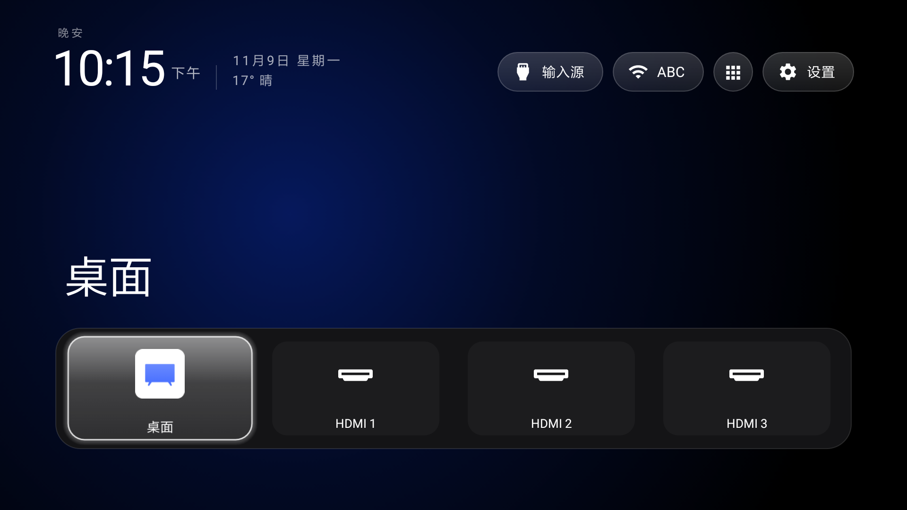

> **Xiaomi Mi TV 4C 55-inch · Android 6.0.1 (API 23).** A fork of
> [Gathin23/cleanyourtv](https://github.com/Gathin23/cleanyourtv) that runs on one 2016 Xiaomi set.
> Fork-specific detail, merge rules and the upgrade path live in
> [ADAPTATION.md](ADAPTATION.md) and [docs/devices/xiaomi-mitv4c-ansm0.md](docs/devices/xiaomi-mitv4c-ansm0.md).

<p align="center">
  
</p>

<p align="center">
  English · <a href="README.zh-CN.md">中文</a>
</p>

# CleanYourTV on a Xiaomi Mi TV 4C 55-inch

| | |
| --- | --- |
| Model | Xiaomi Mi TV 4C 55-inch, `MiTV4-ANSM0` |
| Product / board | `xmen` / `gxbaby` |
| System | Android 6.0.1, API 23 |
| ABI | `armeabi-v7a` |
| Panel | 1920 × 1080 |

This branch continues [qqwersde/my-tv-signal-android6](https://github.com/qqwersde/my-tv-signal-android6),
which adapted the upstream launcher to Android 6, and carries upstream main through
[`15b3e5ac`](https://github.com/Gathin23/cleanyourtv/commit/15b3e5ac). The Home key work, the boot
behaviour, the HDMI rows and the API 23 guards below were done on this set. Nothing upstream added
was dropped. The launcher is MIT, copyright Gathin; Outfit ships under the SIL Open Font License.
Unofficial fork.


## Build and install

JDK 17 or 21, Android SDK platform 34, build-tools 34.0.0. From `launcher/`:

```bash
./gradlew assembleRelease -PlauncherMinSdk=23
```

Without `-PlauncherMinSdk=23` the default `minSdk` stays 26 and the APK will not install on API 23.
The artefact is `launcher/app/build/outputs/apk/release/app-release.apk`.

```bash
adb install -r --user 0 launcher/app/build/outputs/apk/release/app-release.apk
```

A re-install drops the accessibility binding every time. On this set the reliable way back is to
remove the entry first and then add it — flipping `accessibility_enabled` 0/1 alone does not rebind:

```bash
adb shell settings delete secure enabled_accessibility_services
adb shell settings put secure accessibility_enabled 0
adb shell settings put secure enabled_accessibility_services com.gathin.tvhome/.HomeKeyService
adb shell settings put secure accessibility_enabled 1
```

Wait a few seconds after the last write; the service binds when the system re-reads the list.

## What changed

### Home key: one broadcast is the only hook

A short press arrives as the system's `ACTION_CLOSE_SYSTEM_DIALOGS` broadcast with `reason=homekey`
(`from uid 1000` is the firmware, `from uid 10004` is this launcher), and `openHome()` runs 800 ms
later. A long press arrives as the same broadcast with `reason=recentapps` and is deliberately left
alone, so Xiaomi's task switcher opens and nothing else comes with it.

The manifest also declares the HOME filter at `android:priority="999"`, above the stock home's 100,
which makes this launcher a candidate for the HOME intent. The key itself still goes through the
firmware's own dispatch — the broadcast is what does the actual work.

### The three fallbacks that broke Back are gone

`foregroundCheck`'s trailing redirect, `onAccessibilityEvent`'s `stockHome.contains(name)` check and
`stockHomeReopened()` all read "PatchWall is in front again" as "Home was pressed". That is why Back
inside a second-level PatchWall page, and a long Home press, both jumped to this launcher. All three
are removed. `onKeyEvent` has no `KEYCODE_BACK` branch and needs none, because the firmware does not
route Back into the accessibility filter either. Back now belongs to the app in front.

### Boot first screen

Upstream's `probeAtBoot()` never ran here: it reads `Settings.Global.BOOT_COUNT`, which returns
`null` on this set. `bootTakeover()` treats the accessibility binding as the boot signal instead and
polls once a second for 90 s (`BOOT_WATCH_MS`). The window exists because the firmware starts
PatchWall first and this launcher second; the last frame of that window is the new home.

### PatchWall stays where you put it

The old 60 s release window is gone. `stockHomePassthrough` is permanent while this launcher is the
default, so opening PatchWall from the app library leaves it there instead of handing back on a timer.

Coming back: **My Apps → Home Screen**. `strings.xml` names this app after the Home Screen entry
PatchWall's list offers, and that tap lands here. The direct route is blocked on this firmware:

```text
SecurityException: requires com.mitv.tvhome.permission.HOME_STATE
```

### HDMI 1–3 in the app library

Three virtual rows, stored by `LibraryApps` as `input:<port>`:

| Row | Extras | Opens |
| --- | --- | --- |
| HDMI 1 | `input` = 23 | `com.xiaomi.mitv.tvplayer/.ExternalSourceActivity` |
| HDMI 2 | `input` = 24 | same activity |
| HDMI 3 | `input` = 25 | same activity |

Action `com.xiaomi.mitv.tvplayer.EXTSRC_PLAY`, int extra `input`, flags `0x10008000`
(`NEW_TASK | CLEAR_TASK`). `CLEAR_TASK` is not optional: without it the activity reuses itself and
HDMI 2 and HDMI 3 come up black. The row icon is `ic_hdmi.png`, the white socket lifted from this
set's own `MiTVTVPlayer.apk`.

### Library rows behave like app rows

Short OK pins the row to Home and it flips to "already on Home"; long OK opens the row menu (add to
Home / remove from Home / App info). `AppLibraryDialog` gained the catalog filter and these actions
for `input:` rows, and `AppAdapter` draws them. The stock-home entry takes a separate branch because
it is not an installed package.

### What the merge kept

From `15b3e5ac`, with this set's settings: `power_on_home` and `power_on_home_always`,
`guard_off_in_standby`, the `app_keys` front rows, the tile long-press menu (`holdOk`), the glass
focus rect, collapsing unconnected input sources, and the weather line.

Two of them had to be redone for API 23. `UserManager.isUserUnlocked()` (Android 7) and `String.join`
(Android 8.1) appear in upstream code behind `SDK_INT` guards, but desugaring rewrites library APIs
only — the first bind threw `NoSuchMethodError` and took the whole accessibility service down. Both
are now either outside the call on API 23 or hand-joined. Detail in [ADAPTATION.md](ADAPTATION.md).

## Known limits

Two properties of this firmware account for most of the entries below.

**The Home key never reaches an app.** `MitvPhoneWindowManager` dispatches `KEYCODE_HOME` straight to
the foreground window, and `dumpsys accessibility` on this set shows a service receives only
`TYPE_WINDOW_STATE_CHANGED` — no key events at all. The key cannot be swallowed, only reacted to.

**PatchWall is the system home.** `com.mitv.tvhome` is an updated system app with HOME priority 100,
and `pm disable-user` / `pm hide` are refused here (`MANAGE_USERS`). Nothing is uninstalled: unused
apps are hidden by the launcher config, and the stock home is always one tap away in the app library.
| You will notice | Because | What it means |
| --- | --- | --- |
| A Home press takes about five seconds | The firmware routes it to PatchWall first, then this launcher cold-starts; the merged build also draws tiles and scans apps | Correct, but not instant |
| Back cannot be intercepted | No key events reach accessibility on this firmware | Do not add a `KEYCODE_BACK` branch |
| Long Home opens Xiaomi's task switcher | The firmware sends `reason=recentapps`, which is ignored on purpose | It keeps the screenshot and clear-all this set ships with; this launcher has no recents screen of its own |
| App info may not open | The settings app does not handle the standard application-details intent | — |
| `pm disable-user` and `pm hide` are refused | `MANAGE_USERS` | `tools/disable.sh` and a full `tools/restore.sh` do not apply to this TV |

## Following upstream

```bash
git fetch upstream
git log --oneline HEAD..upstream/main      # what is new
git merge upstream/main                    # conflicts: behaviour from here, structure from upstream
```

Then rebuild with `-PlauncherMinSdk=23`, install, and walk these before calling it done:

- [ ] The home screen renders
- [ ] The Desktop tile opens PatchWall
- [ ] Back inside a second-level page stays put
- [ ] Home from PatchWall returns here
- [ ] Long Home opens Xiaomi recents only
- [ ] An HDMI entry opens `ExternalSourceActivity`
- [ ] The first screen after a reboot is this launcher

After every merge, re-scan for API 24+ framework calls: the merge compiles fine and only fails on the
TV.

## Licence

MIT, see [`LICENSE`](LICENSE). The Outfit typeface is under the SIL Open Font License, see
`launcher/FONT-LICENSE-OFL.txt`.
