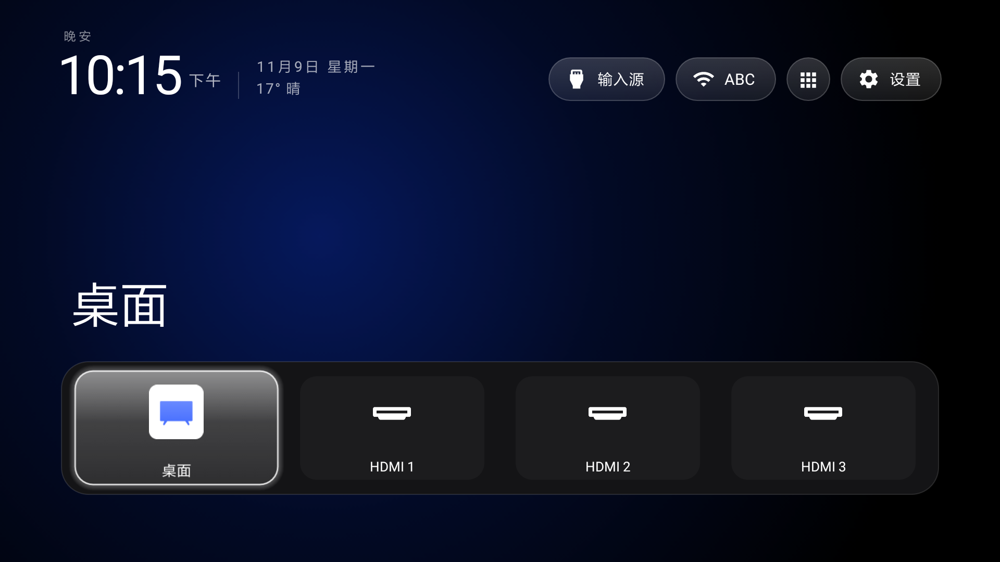

> **小米电视 4C 55 寸 · Android 6.0.1（API 23）。** 本仓库是
> [Gathin23/cleanyourtv](https://github.com/Gathin23/cleanyourtv) 在单台 2016 年小米电视上的适配分支。
> 本机专属改动、合并规则与主线跟进方法见 [ADAPTATION.md](ADAPTATION.md) 与
> [docs/devices/xiaomi-mitv4c-ansm0.md](docs/devices/xiaomi-mitv4c-ansm0.md)。

<p align="center">
  
</p>

<p align="center">
  <a href="README.md">English</a> · 简体中文
</p>

# 小米电视 4C 55 寸上的 CleanYourTV

| | |
| --- | --- |
| 机型 | 小米电视4C 55 寸，`MiTV4-ANSM0` |
| 产品 / 板 | `xmen` / `gxbaby` |
| 系统 | Android 6.0.1，API 23 |
| ABI | `armeabi-v7a` |
| 屏幕 | 1920 × 1080 |

本分支延续 [qqwersde/my-tv-signal-android6](https://github.com/qqwersde/my-tv-signal-android6)
（该分支将上游桌面适配至 Android 6），并将上游主线跟进至
[`3b6b3a15`](https://github.com/Gathin23/cleanyourtv/commit/3b6b3a15)。上游以 rebase 方式跟进，
因此本分支在上游历史之上只有一条自有提交。下文所述的 Home 键处理、开机行为、
HDMI 行与 API 23 兼容处理均在本机完成；上游新增内容均已保留。桌面本体采用 MIT 许可证，版权归 Gathin；
Outfit 字体采用 SIL Open Font License。本项目为非官方分支。

## 编译与安装

需要 JDK 17 或 21、Android SDK platform 34 与 build-tools 34.0.0。在 `launcher/` 目录下执行：

```bash
./gradlew assembleRelease -PlauncherMinSdk=23
```

未指定 `-PlauncherMinSdk=23` 时，默认 `minSdk` 仍为 26，APK 无法安装至 API 23 设备。构建产物位于
`launcher/app/build/outputs/apk/release/app-release.apk`。

```bash
adb install -r --user 0 launcher/app/build/outputs/apk/release/app-release.apk
```

覆盖安装每次都会解除无障碍服务绑定。本机可靠的重新绑定方式是先删除条目再重新添加；仅切换
`accessibility_enabled` 的 0/1 无法完成绑定：

```bash
adb shell settings delete secure enabled_accessibility_services
adb shell settings put secure accessibility_enabled 0
adb shell settings put secure enabled_accessibility_services com.gathin.tvhome/.HomeKeyService
adb shell settings put secure accessibility_enabled 1
```

最后一条写入后需等待数秒，系统重新读取列表时服务方完成绑定。

## 改了什么

### Home 键：仅有一条广播可用

短按会以 `reason=homekey` 随系统的 `ACTION_CLOSE_SYSTEM_DIALOGS` 广播送达（`from uid 1000` 为固件发送，
`from uid 10004` 为本桌面发送），800 毫秒后执行 `openHome()`。长按到达的是同一广播、`reason=recentapps`，
此处刻意不作处理，因此小米自带的任务切换器按原行为弹出，且不会同时打开本桌面。

清单中的 HOME 过滤器声明了 `android:priority="999"`，高于系统桌面的 100，使本桌面成为 HOME intent 的
候选；但按键本身仍由固件派发，实际生效的是该广播。

### 导致返回键异常的三处兜底逻辑已删除

`foregroundCheck` 末尾的重定向、`onAccessibilityEvent` 中的 `stockHome.contains(name)` 判断，以及
`stockHomeReopened()`，这三处均将「PatchWall 重新回到前台」判定为「用户按下了 Home 键」。PatchWall
二级页内按返回键跳回本桌面、长按 Home 时同时打开本桌面，均由它们导致。三处均已删除。`onKeyEvent` 中
原本不存在 `KEYCODE_BACK` 分支，也无需添加，因为固件同样不向无障碍服务投递返回键。返回键现由前台应用
自身处理。

### 开机首屏

上游的 `probeAtBoot()` 在本机从未实际执行：该方法读取 `Settings.Global.BOOT_COUNT`，本机返回 `null`。
`bootTakeover()` 改为以无障碍服务绑定时作为开机信号，随后每秒轮询一次、持续 90 秒（`BOOT_WATCH_MS`）。
该窗口是必要的：固件先启动 PatchWall、再启动本桌面，窗口内最后一次落定的界面才是新桌面。

### PatchWall 保持停留

原先的 60 秒放行窗口已删除。只要本桌面仍为默认桌面，`stockHomePassthrough` 即保持常驻：从应用库打开
PatchWall 后，PatchWall 将保持停留，不会在定时到期后自动返回。

返回本桌面的方式为 **我的应用 → 主屏幕**。`strings.xml` 将本应用的显示名称设为 PatchWall 列表中的
「主屏幕」条目，点击后即返回本桌面。直接启动的方式在本机固件上不可用，系统会拒绝该调用：

```text
SecurityException: requires com.mitv.tvhome.permission.HOME_STATE
```

### HDMI 1–3：按本机的方式显示连接状态

新增三行虚拟条目，由 `LibraryApps` 以 `input:<端口号>` 形式持久化，均打开
`com.xiaomi.mitv.tvplayer/.ExternalSourceActivity`：

| 行 | `input` extra | 面板插口 | 固件 input |
| --- | --- | --- | --- |
| HDMI 1 | 23 | HDMI 1 | `Hdmi3InputService/HW7` |
| HDMI 2 | 24 | HDMI 2 | `Hdmi2InputService/HW6` |
| HDMI 3 | 25 | HDMI 3 | `Hdmi1InputService/HW5` |

action 为 `com.xiaomi.mitv.tvplayer.EXTSRC_PLAY`，int extra 为 `input`，flags 为 `0x10008000`
（`NEW_TASK | CLEAR_TASK`）。`CLEAR_TASK` 为必需参数：缺少该标志时该 activity 会复用自身实例，
HDMI 2 与 HDMI 3 将显示为黑屏。

**固件的端口编号是反的。** 它的 `Hdmi1InputService` 对应面板上标着 HDMI 3 的插口，
`Hdmi3InputService` 才是 HDMI 1；而 tvplayer 的 `input` 号仍按面板排列。因此 `input_sources`
写为 `HW7=23、HW6=24、HW5=25`，而非 MStar 惯例的 `HW5=23`。按顺序填写时，插在 HDMI 3 上的设备
会让 HDMI 1 磁贴变亮；随后分别在 HDMI 3、HDMI 1 接入设备，对照 `dumpsys tv_input` 复核了该对应关系。

**两种图标对应两种状态。** 有设备的端口显示白色 `ic_hdmi.png`，空置端口显示灰色 `ic_hdmi_dim.png`。
用两张位图是有原因的：`ic_hdmi.png` 就是本机 `MiTVTVPlayer.apk` 里的同一个文件（SHA-256 一致），
而从同一资源加载的 drawable 共享 constant state，对其中一个端口设 `ColorFilter` 会把三个端口一起变灰。

**端口判定** 依据本固件的一个特性：只有设备在线时，DroidLogic 才把该口注册进 `TvInputManager`。
接 HDMI 2 时输入列表里只有 `Hdmi2InputService/HW6`；拔掉后一个 HDMI input 都不注册，而三个服务仍在运行。
因此「配置里有、注册列表里没有」即为空口。无法判定时（没有 `TvInputManager`、列表为空、该口没有映射）
保持图标为亮，避免把能用的口误判成空口。

**热插拔无需轮询。** `onInputStateChanged`、`onInputAdded`、`onInputRemoved` 都会调用
`reloadInputIcons()` 重载磁贴与应用库，按下按键的当下即可看到变化。

**绿点** 用于在主屏磁贴上标注已连接的端口，与系统「信号源」面板的标记一致。
`HdmiPorts.tileName()` 以 `ReplacementSpan` 在其后追加一个直径 `0.6 × textSize`、间距
`0.30 × textSize` 的圆点，按行框中心绘制：字符 `"●"` 贴着基线会显得偏低，而 compound drawable
固定在控件右边缘，会离居中文字太远。

### 应用库中的行与普通应用行为一致

短按 OK 将该行添加到主屏，状态变为「已在主屏幕」；长按 OK 打开该行菜单（添加到主屏幕 / 从主屏幕移除 /
应用信息）。`AppLibraryDialog` 增加了分类过滤及针对 `input:` 行的上述动作，`AppAdapter` 负责绘制。
系统桌面条目单独处理，因为它并非已安装的应用包。

### 自上游合并保留的内容

自上游保留、按本机配置生效的内容：`power_on_home` 与 `power_on_home_always`、
`guard_off_in_standby`、`app_keys` 前置行、磁贴长按菜单（`holdOk`）、玻璃框焦点、未连接输入源折叠，
以及天气信息行。这些条目在第一次合并时自 `15b3e5ac` 引入，rebase 到 `3b6b3a15` 后悉数保留。

其中两处必须针对 API 23 重做。`UserManager.isUserUnlocked()`（Android 7 起提供）与 `String.join`
（Android 8.1 起提供）在上游代码中位于 `SDK_INT` 判断之内，但 desugaring 仅重写库层 API，不处理
framework 方法：首次绑定时即抛出 `NoSuchMethodError`，导致整个无障碍服务终止。现两处处理方式为：在
API 23 上不进入该调用，或改为手工拼接。细节见 [ADAPTATION.md](ADAPTATION.md)。

## 已知局限

下列限制主要由本机固件的两项特性决定。

**Home 键事件不会送达应用。** `MitvPhoneWindowManager` 将 `KEYCODE_HOME` 直接派发至前台窗口；本机
`dumpsys accessibility` 显示无障碍服务仅接收 `TYPE_WINDOW_STATE_CHANGED`，不接收任何按键事件。该按键
无法被拦截，只能在事件发生后再行响应。

**PatchWall 即系统桌面。** `com.mitv.tvhome` 是更新后的系统应用，HOME 优先级为 100；本机固件拒绝执行
`pm disable-user` 与 `pm hide`（`MANAGE_USERS`）。本适配未卸载任何应用：不使用的应用仅通过桌面配置隐藏，
系统桌面仍可在应用库中随时打开。

| 现象 | 原因 | 说明 |
| --- | --- | --- |
| 按 Home 后约需五秒 | 固件先将该按键事件交由 PatchWall 处理，随后本桌面冷启动；合并版还需绘制磁贴并重新扫描应用 | 功能正常，响应存在延迟 |
| 返回键无法拦截 | 本机固件不向无障碍服务投递按键事件 | 不应再添加 `KEYCODE_BACK` 分支 |
| 长按 Home 打开小米自带任务切换器 | 固件发送 `reason=recentapps`，本适配刻意不作处理 | 该界面自带截图与清空全部功能；本桌面不提供独立的最近任务页 |
| 「应用信息」可能无法打开 | 本机设置应用不支持标准的应用详情 intent | — |
| `pm disable-user` 与 `pm hide` 被拒绝 | `MANAGE_USERS` | `tools/disable.sh` 与完整的 `tools/restore.sh` 不适用于本机 |

## 跟主线

```bash
git fetch upstream
git log --oneline HEAD..upstream/main      # 查看本次需要跟进的提交
git merge upstream/main                    # 冲突处理：行为以本分支为准，结构以上游为准
```

随后以 `-PlauncherMinSdk=23` 重新编译并安装，完成以下验证后方可视为完成：

- [ ] 主屏正常渲染
- [ ] 点击「桌面」磁贴进入 PatchWall
- [ ] 二级页内按返回键停留在当前页面
- [ ] PatchWall 内按 Home 返回本桌面
- [ ] 长按 Home 仅打开小米任务切换器
- [ ] HDMI 入口打开 `ExternalSourceActivity`
- [ ] 重启后首屏为本桌面

每次合并后还需重新检查 API 24 及以上的 framework 调用：合并本身可正常编译，问题仅在设备运行时暴露。

## 许可

MIT，见 [`LICENSE`](LICENSE)。Outfit 字体采用 SIL Open Font License，见
`launcher/FONT-LICENSE-OFL.txt`。
